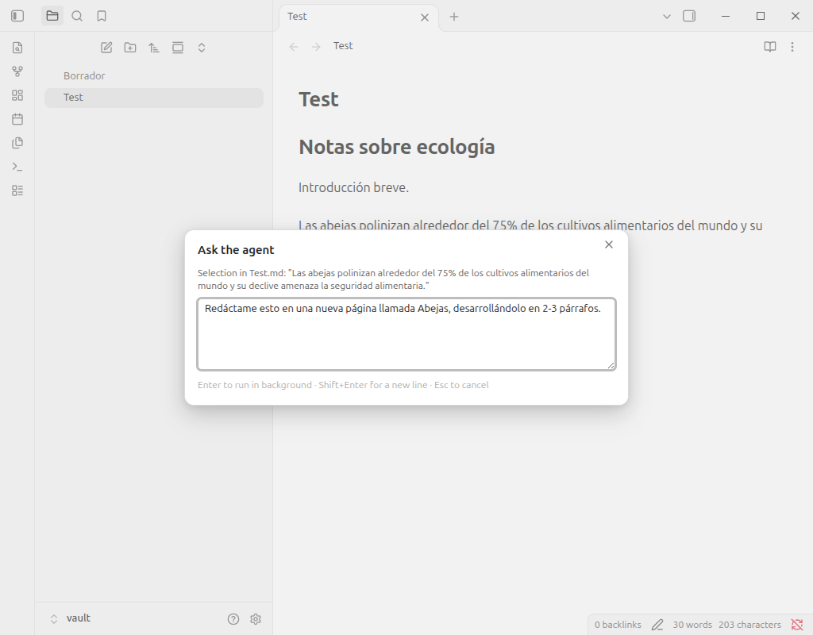
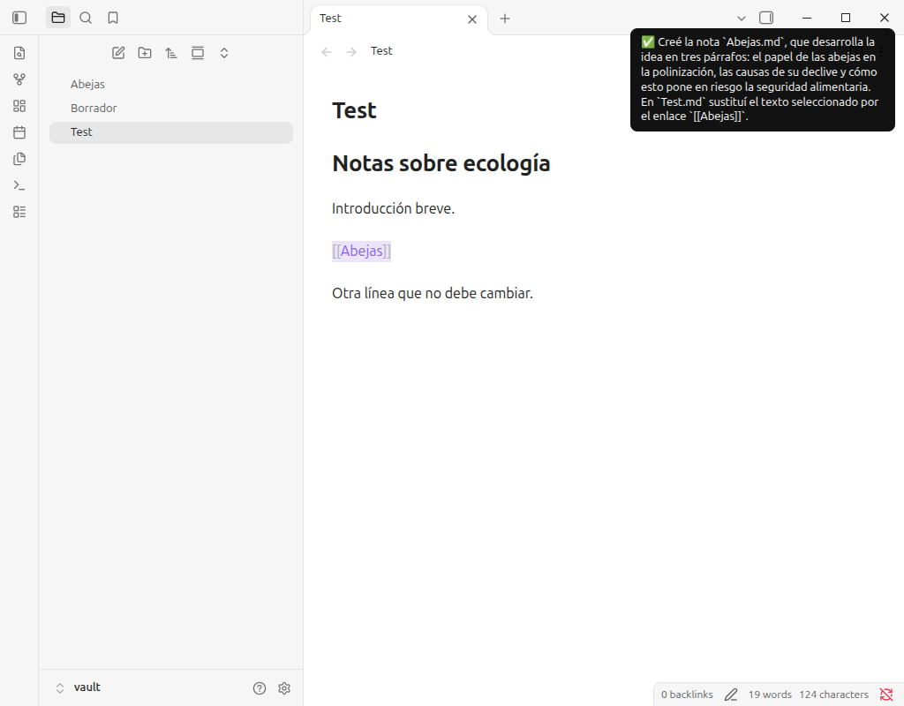

# Agent Prompt for Obsidian

Select some text, press `Ctrl/Cmd+J`, type an instruction and press Enter. The plugin runs a CLI agent (Claude Code in v0.1) in the background, inside your vault folder, and the agent edits your Markdown files.

Example: you select a paragraph and write "Redáctame esto en una nueva página". The agent creates `New note.md` with the expanded text and replaces your selection with `[[New note]]`. It leaves the rest of the note alone.

| Prompt | Result |
| --- | --- |
|  |  |

## How it works

Each run starts from scratch. The plugin sends the agent the path of the active note, your selection (with its line and column range) or your cursor position, and your instruction. The agent reads and writes the files on disk, and Obsidian reloads them.

The agent also gets a system prompt about Obsidian: notes are `.md` files, links use `[[wikilinks]]`, frontmatter stays, `.obsidian/` stays untouched, edits stay small, and new notes go in the same folder as the active one.

If you select nothing, the instruction applies to the whole note, with focus on the text before your cursor. Try "mejora esta nota".

The plugin runs this command:

```
claude -p --output-format json --permission-mode acceptEdits \
       --append-system-prompt "<obsidian rules>" \
       --allowedTools=Read,Write,Edit,MultiEdit,Glob,Grep,LS   < task-on-stdin
```

The default tool list leaves out `Bash`, so the agent can only read and edit files in your vault.

## Install

You need the Obsidian desktop app and a CLI agent you have already logged into. Run `claude` once in a terminal first.

### Manual

1. Download `main.js`, `manifest.json` and `styles.css` from the [latest release](https://github.com/balalofernandez/obsidian-agent-prompt/releases/latest).
2. Copy them into `<your vault>/.obsidian/plugins/agent-prompt/`.
3. In Obsidian, open Settings → Community plugins and enable Agent Prompt.

### BRAT

Add `balalofernandez/obsidian-agent-prompt` as a beta plugin.

### From source

```bash
git clone https://github.com/balalofernandez/obsidian-agent-prompt && cd obsidian-agent-prompt
npm install && npm run build
mkdir -p "$VAULT/.obsidian/plugins/agent-prompt" && cp main.js manifest.json styles.css "$VAULT/.obsidian/plugins/agent-prompt/"
```

## Usage

| Command | Default hotkey |
| --- | --- |
| Agent Prompt: Run agent on selection / note | `Ctrl/Cmd+J` |
| Agent Prompt: Cancel running agent | none |

Change the hotkey in Settings → Hotkeys, or use the button in the plugin settings. While the agent runs, the status bar shows `🤖 Claude Code working…`. When it finishes, a notification shows the agent's summary.

## Settings

- CLI agent: the backend to use. Claude Code is the only option for now.
- Executable: `claude` or an absolute path. Apps launched from a dock don't get your shell `PATH`, so the plugin adds `~/.local/bin`, `~/.claude/local`, `/usr/local/bin`, `/opt/homebrew/bin` and a few others. The Test button runs `--version`.
- Model, allowed tools, extra arguments: one set per agent.
- Timeout, extra instructions (appended to the system prompt), result notification on/off.

## Adding another agent (Codex, Gemini CLI, ...)

Implement `AgentRunner` in `src/agents/AgentRunner.ts` and register it in `src/agents/registry.ts`:

```ts
export interface AgentRunner {
  id: string; displayName: string; defaultBinary: string; defaultAllowedTools: string;
  buildInvocation(req: AgentRequest, cfg: AgentConfig): { command: string; args: string[]; stdin?: string; env?: Record<string,string> };
  versionArgs(): string[];
  parseResult(stdout: string, stderr: string, exitCode: number | null): { ok: boolean; summary: string };
}
```

`src/runProcess.ts` handles spawning, `PATH`, timeouts and cancellation for every agent. The settings dropdown lists every registered agent.

## Development and tests

```bash
npm run dev     # esbuild watch
npm run build   # typecheck + production bundle
npm test        # unit tests (vitest)
npm run e2e     # end-to-end in a real Obsidian
```

`test/e2e/run.mjs` launches Obsidian with its own config folder (`XDG_CONFIG_HOME`) and a throwaway vault, installs the built plugin and connects through the Chrome DevTools Protocol with Playwright's `connectOverCDP`. It selects text, presses `Ctrl+J`, types a prompt and checks two cases on disk:

1. With a selection, the agent creates `Abejas.md` and replaces the selection in the original note with `[[Abejas]]`. The rest of the note stays the same.
2. With no selection, the agent fixes the spelling in a draft note.

Set `OBSIDIAN_BIN` to your Obsidian executable or AppImage. The default is `~/AppImages/obsidian.appimage`. The test calls the real agent twice and saves screenshots to `test/e2e/.run/screenshots/`.

## License

MIT
